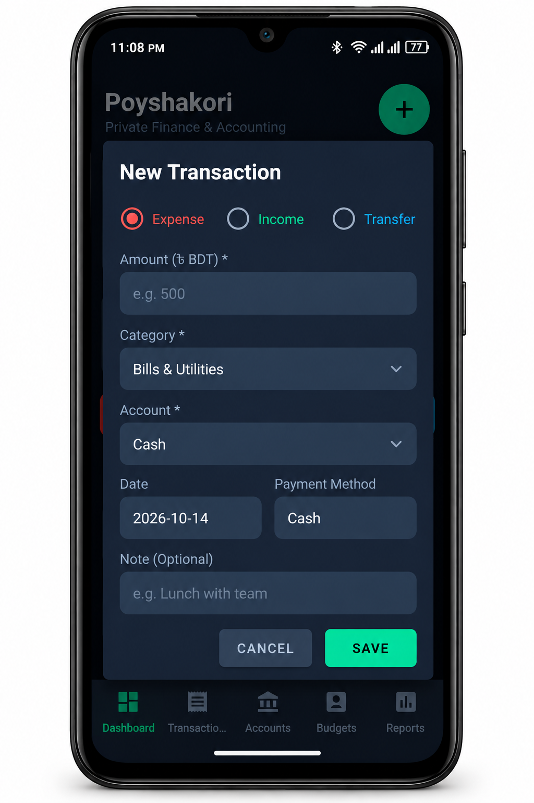
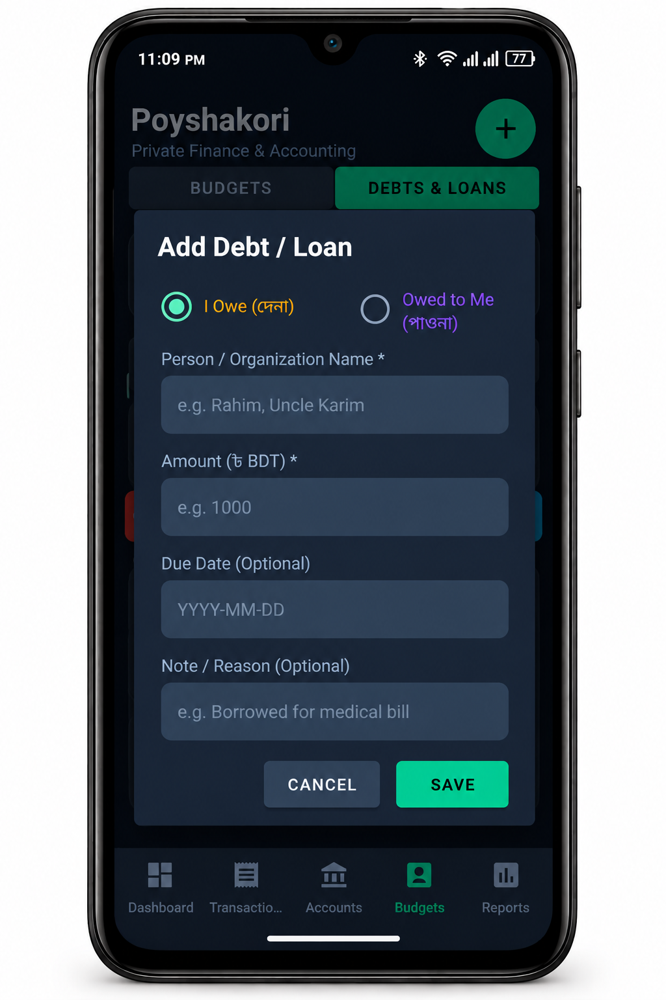
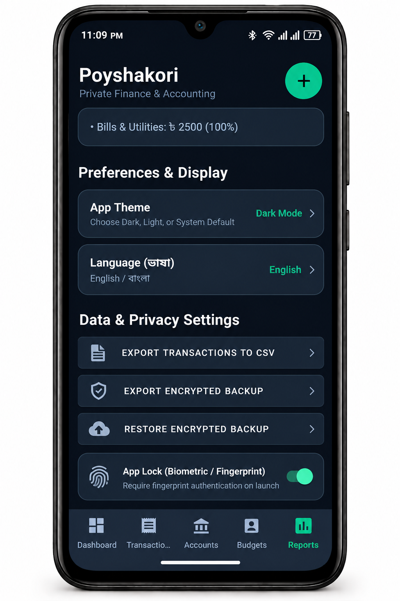

<div align="center">

  

  # Poyshakori (পয়শাকড়ি)
  **Private, Offline-First Personal Finance & Accounting for Android**

  Take complete control of your money with zero tracking, biometric security, and strict accounting integrity.

  <br/>

  [-3DDC84?style=for-the-badge&logo=android&logoColor=white)](https://developer.android.com)
  [](https://kotlinlang.org)
  [](https://m3.material.io)
  [-F58220?style=for-the-badge&logo=sqlite&logoColor=white)](https://developer.android.com/training/data-storage/room)
  [](https://developer.android.com/training/sign-in/biometric-auth)
  [](LICENSE)

  <br/><br/>

  [-2ea44f?style=for-the-badge&logo=android&logoColor=white)](https://github.com/sobuj-here/Poyshakori/releases/download/v5.0/poyshakori-v5.0.apk)

</div>

---

## 📱 App Screenshots

<div align="center">
  <table>
    <tr>
      <td align="center"><strong>Dashboard & Net Worth</strong></td>
      <td align="center"><strong>New Transaction & Service Fee</strong></td>
      <td align="center"><strong>Debt, Loan & Rescheduling</strong></td>
      <td align="center"><strong>Security & Unified Backup</strong></td>
    </tr>
    <tr>
      <td align="center"></td>
      <td align="center"></td>
      <td align="center"></td>
      <td align="center"></td>
    </tr>
  </table>
</div>

---

## 🚀 What's New in Version 5.0

- 💸 **Mobile Banking Service Fee (Float / Decimal)**: Full support for decimal transaction fees (e.g. 18.50 BDT, 14.90 BDT) during inter-account transfers (bKash, Nagad, Rocket, Bank). Deducts accurately from the source account without artificially altering transfer principal.
- 📅 **Loan Rescheduling & Extension**: Easily extend or change due dates when a borrower requests more time, or schedule the remaining balance date when a partial repayment is recorded.
- 🤝 **Excess Payment Handling ("সে ফেরত পাবে" / Refund Excess)**: When a debtor pays more than owed, the surplus is cleanly tracked as refundable excess ("সে ফেরত পাবে" / He is owed), with a one-click settlement button.
- 📦 **Auto-Archiving 0-Balance Loans**: Fully settled loans (balance = 0) automatically exit the active Debts & Loans tab and reside directly in the Transactions ledger for clean bookkeeping.
- 🔔 **Smart Notification Throttling**: Loan reminders are capped at 2–3 times in a 24-hour window with a mandatory 4-hour cooldown interval to avoid spam when reopening the app repeatedly.
- 💾 **Single-File Unified Encrypted Backup**: Consolidated all backup assets into one encrypted `.pbackup` archive.
- 🔍 **Transactions "Debts & Loan" Tab Filter**: Filter and inspect all debt disbursements and repayments directly in the Transactions tab.

---

## 📖 About Poyshakori

**Poyshakori** is an offline-first personal accounting and wealth management system engineered for Android. It bridges the gap between simple daily expense trackers and formal double-entry accounting software. 

Unlike conventional financial apps that upload sensitive banking records to cloud servers, Poyshakori keeps **100% of your financial data strictly on your device**. It does not request or possess the Android Internet permission, guaranteeing complete data sovereignty and zero surveillance.

---

## 🌟 Key Features

### 📊 1. Comprehensive Financial Dashboard
- **Total Net Worth**: Live aggregated balance calculated across all active accounts.
- **Income vs. Expense Summaries**: Instant monthly totals with real-time percentage indicators.
- **Quick Action Bar**: Fast entry shortcuts for `+ Income`, `- Expense`, and `⇄ Transfer`.
- **Live Transaction Feed**: Most recent activity stream with full inspection capabilities.

### 💳 2. Multi-Account & Wallet Management
- Manage **Cash**, **Bank Accounts**, and **Mobile Wallets** (bKash, Nagad, Rocket, Upay, etc.).
- Continuous balance validation derived directly from verified transaction records.
- **Inter-Account Transfers with Service Fee**: Move funds between accounts with optional decimal service fees.

### 🧾 3. Transaction Management & Filters
- Full CRUD operations (Create, Read, Update, Delete) for income, expense, and transfer records.
- Fast multi-criteria search by category name, notes, reference ID, or amount.
- Quick filter tabs: **All**, **Expense**, **Income**, **Transfer**, and **Debts & Loan**.
- Automatic balance reconciliation upon transaction modification or deletion.

### 🎯 4. Budgets & Spending Limits
- Define custom monthly spending caps per expense category.
- Visual progress meters illustrating actual spending versus allocated budgets.
- Threshold warnings when approaching or exceeding spending ceilings.

### 🤝 5. Debts & Loans Tracking
- Track money you owe (**Payables / Debts**) and money owed to you (**Receivables**).
- Reschedule due dates, record partial payments with follow-up dates, and settle excess refunds.
- Zero-balance loans are cleanly auto-archived.

### 📈 6. Visual Analytics & Reporting
- Hardware-accelerated custom Canvas donut chart with touch-friendly tooltips.
- Monthly breakdown comparison and exportable audit summaries.

### 🔐 7. Security, Biometric App Lock & Unified Backup
- Biometric authentication (Fingerprint / Face Unlock).
- Unified single-file AES-256 encrypted database backup and restore (`.pbackup`).
- One-click CSV export.

---

## ⚖️ Accounting Integrity Invariants

Poyshakori guarantees mathematical accuracy across all records through strict accounting invariants:

1. **Floating / Decimal Precision for Fees**: Accounts accurately track floating-point balances without precision loss.
2. **Income Invariant**: Adds the exact transaction value to the target account's `currentBalance`.
3. **Expense Invariant**: Deducts the exact transaction value from the source account's `currentBalance`.
4. **Transfer Conservation**: Moves funds between accounts with exact service fee accounting:
   ```text
   Source Account = Source Balance - (Transfer Amount + Service Fee)
   Target Account = Target Balance + Transfer Amount
   ```
5. **Reversal on Update/Delete**: Whenever a transaction is modified or removed, its historical balance effects are atomically rolled back before the new state is applied.

---

## 🔒 Security & Privacy Guarantees

- **Zero Network Permissions**: The app manifests **NO** `android.permission.INTERNET`. It is physically incapable of transmitting your financial data outside your device.
- **No Third-Party Trackers**: Clean of analytics SDKs, crash trackers, or advertising frameworks.
- **Military-Grade Local Encryption**: Backups are encrypted with AES-256-CBC, authenticated, and derived through PBKDF2 with 10,000 hashing rounds.

---

## 🚀 Building from Source

### Prerequisites
- **JDK 17** installed and configured (`JAVA_HOME`).
- **Android SDK** with platform tools (minSdk 24, targetSdk 34).
- **Android Studio Hedgehog (2023.1.1)** or newer.

### Build Commands

```bash
# Clone the repository
git clone https://github.com/sobuj-here/Poyshakori.git
cd Poyshakori

# Run unit tests
./gradlew testDebugUnitTest

# Assemble Debug APK
./gradlew assembleDebug
```

The generated APK will be located at:
```text
app/build/outputs/apk/debug/app-debug.apk
```

---

## 📥 Direct APK Installation

You can install the pre-built release APK directly on any Android device running Android 7.0 (API 24) or higher:

1. Download **[`poyshakori-v5.0.apk`](poyshakori-v5.0.apk)**.
2. Open the downloaded file on your Android device.
3. If prompted, allow installation from your browser/file manager.
4. Open **Poyshakori** and begin managing your finances securely!

---

## 📄 License

This project is licensed under the **Apache License, Version 2.0**. See the [LICENSE](LICENSE) file for complete details.

---

<div align="center">

Crafted with care by **[Md. Sobuj Ali](https://github.com/sobuj-here)**

[](https://github.com/sobuj-here)

</div>