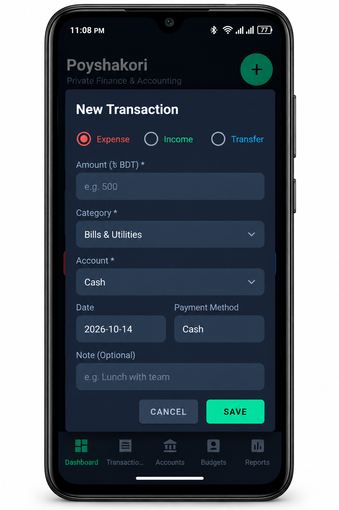
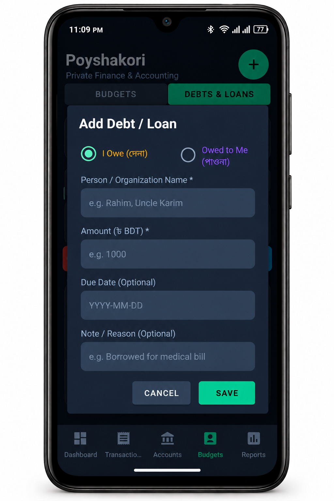
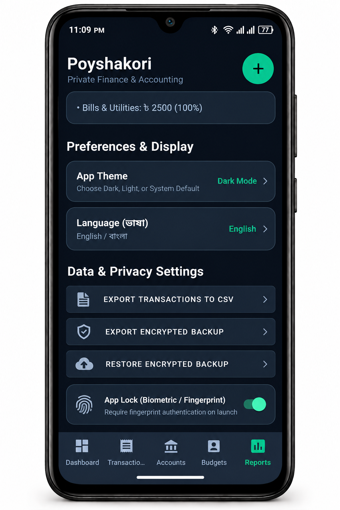

  

<h1 align="center">Poyshakori</h1>

  <strong>Take Control of Your Money.</strong>

  A privacy-focused personal finance and money management app for Android.

  
  
  
  

  

<em>🚧 Currently under development</em>
---
---

## 📖 About Poyshakori

Poyshakori is a personal finance and money management application designed to help individuals track income, manage expenses, organize financial accounts, and gain better control over their money.

Built with a focus on simplicity, privacy, and financial clarity, Poyshakori aims to make everyday money management easier through an intuitive and organized experience.

## ✨ Key Features

- 💰 **Personal Finance Management** — Keep financial records organized in one place.
- 📈 **Income Tracking** — Record and review income from different sources.
- 💸 **Expense Tracking** — Monitor spending and understand where your money goes.
- 🏦 **Account Management** — Organize cash, bank accounts, and mobile wallets.
- 📋 **Transaction History** — Search, filter, and review financial activities.
- 🎯 **Budget Planning** — Set spending limits and monitor your budget.
- 🤝 **Debt Management** — Track money borrowed, lent, and repaid.
- 🐷 **Savings Goals** — Set financial goals and monitor your progress.
- 📊 **Financial Reports** — Review income, expenses, and spending patterns.
- 📱 **Offline-First Experience** — Designed to support core financial tasks offline.
- 🔒 **Privacy-Focused Design** — Emphasizes user control over personal financial information.
- 💾 **Backup & Restore** — Planned support for secure, user-controlled backups.

> Note: Features are planned or in development and may not all be available yet.

## 🛠️ Technology Stack

| Component | Technology |
|---|---|
| Platform | Android |
| Language | Kotlin |
| UI Framework | Jetpack Compose |
| Architecture | MVVM |
| Local Database | Room (SQLite) |

## 📱 App Screenshots

  
  

  
  

## 🔐 Privacy & Data Control

Poyshakori is being designed around local data control and offline access.

The goal is to keep core financial records available without requiring a constant internet connection and to provide user-controlled backup options.

## 🎯 Our Vision

From everyday expenses to long-term savings, Poyshakori aims to help users understand their financial habits and make more informed financial decisions—without unnecessary complexity.

## 🚧 Development Status

Poyshakori is currently under development. Features, design, and implementation details may evolve as development progresses.

## 📥 Download

Get the latest Android version of Poyshakori below.

*Poyshakori is currently under development.*

## 🗺️ Future Plans

- [ ] Complete core income and expense management.
- [ ] Improve transaction search and filtering.
- [ ] Develop budgets and savings goals.
- [ ] Add financial reports and summaries.
- [ ] Implement secure backup and restore.
- [ ] Improve the interface and user experience.
- [ ] Prepare for public release.

## 📄 License

A license has not yet been selected. All rights and permissions are reserved by the copyright holder unless otherwise stated.

---

  <strong>Poyshakori — Your Money, Your Control.</strong>

